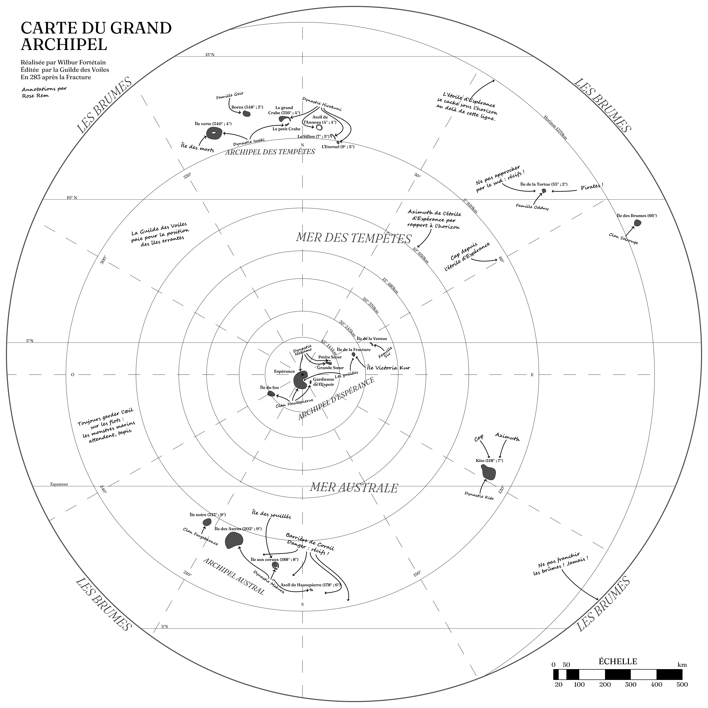

# Le point sur Féerie Network : 2026-01-06

Trois ans... Déjà trois ans depuis les dernières nouvelles et pourtant il s'en est passé des choses.

Mais avant de refaire l'histoire, je vous souhaite, à toutes et à tous, une bonne année et une bonne santé ! Je vous souhaite toute l'énergie et le courage pour affronter ce monde dont l'avenir semble toujours aussi incertain. On en aura tous bien besoin.

Mais laissons les festivités et les faits moins festifs de ce monde de côté et faisons le point sur ce qui s'est passé ces dernières années et les projets en cours.

## Chimère, Série 2

Quand j'ai commencé le projet *3e Terre*, j'avais vraiment besoin d'une coupure vis-à-vis de *Solaires*. C'était l'occasion pour expérimenter un peu, explorer de nouveaux horizons. Le projet a même suffisamment maturé pour commencer une campagne et avoir son nom : *Chimères, Série 2*.

L'idée du jeu : les joueurs incarnent des petites chimères anthropomorphes destinées à servir de compagnon, assistant domestiques ou de mascotte. Elles s'éveillent pour la première fois et se rendent compte qu'elles n'ont pas été livrées là où elles auraient dû. Elles découvrent une jungle épaisse dans laquelle des structures titanesques ont été laissés par des prédécesseurs. Au cours de la campagne, les chimères devront redécouvrir la technologie et reconstruire une civilisation. Dans le même temps, elles auront à explorer l'île sur laquelle elles se trouvent, affronter les dangers qui s'y cachent et même évoluer en s'intégrant des modifications.

Malheureusement, la prémisse première sur laquelle le jeu reposait, explorer l'histoire technologique de l'humanité, s'est avérée bien plus difficile à mettre en œuvre que je ne l'avais prévu. Au point que les autres éléments de l'univers n'ont même pas pu être explorés par les joueurs.

J'ai finalement mis ce projet en pause. Si vous le souhaitez, vous pouvez toujours vous amuser avec le [créateur de personnage](https://dao.feerie.net).

Mais ne vous en faites pas pour ces petites chimères, elles ont déjà trouvé une place dans *Solaires*.

## De Arcana, De Machina

En parallèle, j'ai commencé un second projet, une tentative de créer un univers de fantasy. Prenant inspiration du jeu vidéo *Arcanum* pour ceux qui l'ont connu, cet univers met en scène le basculement de la noblesse tirant son pouvoir de la magie par une révolution industriel. Et comme à mon habitude, le projet a fini par intégrer une teinte de science-fiction lorgnant sur un steampunk un peu hard science. J'ai finalement nommé ce projet de jeu *De Arcana, De Machina*.

L'univers de ce jeu prend part sur un archipel étrange et apparemment complètement isolé du son monde par un mur de brume. Les habitants de l'archipel sont les descendants des rescapés d'une catastrophe industrielle d'un autre monde : la magie utilisée comme source d'énergie devenait plus difficile à obtenir. Pour continuer à approvisionner leur monde, une multinationale a entrepris de creuser un trou dans la réalité pour extraire la magie qui se trouve en dehors : la fracture. Les milliers de travailleurs sur le chantier se sont retrouvé coincés hors du monde lorsque la fracture s'est refermée. C'est en ouvrant une nouvelle fracture que les rescapés ont gagné l'archipel. Privés de leur technologie, la pratique ancestrale de la magie a pris le dessus et une noblesse s'est formée. Mais avec le temps, la technologie perdue s'est redéveloppée et a atteint un niveau qui peut à nouveau rivaliser avec la magie.

L'archipel contient de nombreux dangers, des monstres dangereux et insidieux, une politique de cour impitoyable et bien sûr le conflit naissant entre les nobles qui pratique la magie et le reste du monde porté par la technologie.

Comme *Chimère, Série 2*, ce projet est maintenant en pause. Il est probable que je me replonge un jour dedans, mais *Solaires* et le *Système Féerie* ont repris la priorité.

Voici toutefois une carte de l'archipel :

## Système Féerie V6

J'ai repris les travaux sur le *Système Féerie* V6 qui a pas mal évolué. Cette nouvelle version vise une approche plus modulaire et prend la forme d'un méta-système, une sorte de système pour créer des systèmes.

La mécanique de résolution des actions repart de celle de la version 5 avec plusieurs modifications :
* Plutôt que d'écarter les dés, on compare le résultat du dé médian avec le score à battre. C'est ce que faisait la version 5 *in fine*, mais le résultat du dé est directement utilisable si nécessaire.
* Plusieurs options pour calculer le score du personnage sont proposées, y compris celle de la version 5 (un élément, plus un second si le premier est typique).
* Les niveaux des éléments sont désormais échelonnés de 0 à 4.
* Il faut que la somme du dé médian et score du personnage soit strictement supérieure à la difficulté pour que l'action réussisse.
* Il est maintenant possible d'avoir une qualité de réussite, soit en comparant la différence entre le résultat et la difficulté, soit en prenant en compte les pairs et triples obtenus sur les dés.

Il y a évidemment de nombreuses autres différences avec la version 5. Vous pouvez lire un [premier prototype au format liste à puce](illustrations/SF_v6_0.2.0.pdf).

## Mini-settings

Pour tester et expérimenter le *Système Féerie* V6, j'ai implémenté plusieurs mini-settings et adaptations :
* *Les contes de l'Entremondes* : j'y ai testé une première version du système notamment la variante de la résolution avec jusqu'à trois éléments. L'expérience à la table a été satisfaisante, mais le choix de trois éléments prenait pas mal de temps et lorsque les joueurs ne trouvaient pas assez d'élément, c'était une source d'insatisfaction.
* *Aventures en Tyrie* qui prend place dans l'univers du jeu *Guild Wars 2*. Ce mini setting a surtout été expérimentation de la création de personnage lifepath. Si le document a été plutôt long à rédiger pour son contenu, l'expérience de création des personnages s'est avérée satisfaisante. C'est la première fois que je testais la variante de résolution où le joueur pouvait choisir un second élément pondéré en fonction de la pertinence du premier. L'expérience s'est montrée globalement très concluante.
* *Le monde invisible* qui s'inspire très librement du jeu vidéo *The Secret World* (mais il n'en reprend finalement que le pitch). Une nouvelle expérimentation avec la création via lifepath qui s'est à nouveau montrée concluante bien que coûteuse en temps de rédaction. Là encore, j'ai pu tester la variante de résolution qui utilise deux éléments avec le second modulé par la pertinence du premier.
* *Aventures dans l'empire d'émeraude* qui reprend l'univers du *livre des cinq anneaux*. Pour ce test, j'avais commencé une campagne en dix épisodes dans laquelle les joueurs incarnent des membres du clan du scorpion pris dans les engrenages des complots impériaux. Pour la création des personnages, j'ai testé une sorte de questionnaire dont les réponses permettaient de remplir les informations descriptives des personnages et de créer leurs éléments. Malheureusement, la campagne a été annulée à la fin du second épisode après le départ d'un joueur qui n'appréciait pas le jeu et le souhait d'un autre de ne pas continuer sans lui. Cet échec ne m'a malheureusement pas apporté d'autres données utiles concernant le Système Féerie en soit, mais il m'a confirmé qu'il fallait vraiment bien choisir les joueurs, surtout pour des parties demandant de la proactivité de la part des joueurs.

Notez que la plupart de ces mini-settings sont des adaptations maisons qui ne seront jamais distribués pour des raisons évidentes de droits.

## Travaux futurs

Depuis fin 2025, j'ai repris les travaux sur *Solaires*. Après m'être replongé dans l'univers du jeu, j'ai remis à plat mes idées pour ce jeu et vous trouverez mes réflexions sur le [dépôt git de solaires](https://github.com/Greewi/SolairesSources/blob/feature/version_5.2.0/Working/ChangelogV5.2.md). Pour résumer :
* des précisions sur les capacités des IA et de l'informatique ;
* une nouvelle menace existentielle pour la Terre (et pas que) ;
* une distinction entre les humains et leurs descendants et les artificiels (ces derniers sont quand même plus rares) ;
* quelques modifications sur les psions (encore =D) ;
* revoir le catalogue, notamment dans sa structure.

J'ai aussi commencé à travailler sur une adaptation du *Système Féerie* V6, dont les premières ébauches peuvent aussi être trouvée sur le [dépôt git](https://github.com/Greewi/SolairesSources/blob/feature/version_5.2.0/Working/Adaptation%20SFV6.md). Elles seront très certainement amenées à évoluer, au fil des tests et des travaux qui se poursuivent sur le *Système Féerie*.

Et au niveau des tests, j'ai commencé une campagne qui se concentre sur Sanya avec plusieurs de mes anciens joueurs de Solaires et de nouvelles têtes. Ça va être l'occasion de tester le système et cette nouvelle extension de l'univers. 

Plus récemment, durant décembre, j'ai remis au propre le chapitre du catalogue concernant les modifications, fusionnant et étendant les chapitres *Implants cybernétiques* et *Modifications organiques*. Il s'agit désormais du chapitre [Modifications et Implants](https://github.com/Greewi/SolairesSources/blob/feature/version_5.2.0/Encyclop%C3%A9die/Catalogue/Modifications%20et%20Implants.md).

J'ai aussi commencé à travailler sur le document pour la création des personnages via les lifepath. C'est un sous-projet titanesque qui va devoir se construire au fur et à mesure. Pour le moment, je n'ai fait que les origine de deux des principaux artificiels autant dire une goutte d'eau. Pour le moment, c'est principalement sur ce projet que je vais continuer de me concentrer.

## La jungle mécanique

Oh, j'ai écrit un nouveau roman dans l'univers de *Solaires*... Novembre 2025 se tenait le Novel November, le successeur du feu NaNoWriMo. Pour le moment, c'est encore le premier jet et je ne pense pas m'y replonger avant février (et nous savons tous que le temps a tendance à nous glisser entre les doigts).

*La jungle mécanique - Une chimère, véritable petit robot organique, s'éveille pour la première fois. Destinée à devenir une mascotte pour une société quelconque, elle se retrouve perdue dans une jungle inextricable, loin de son point de livraison supposé. Dans le ciel, bien au-dessus, un pilote de chasse est abattu par les forces d'une menace mécanique qu'on supposait avoir repoussé.*

Pour lire le texte tel qu'il était à la fin du concours rendez-vous sur [Atramenta](https://www.atramenta.net/lire/solaires--jungle-mecanique-novel-november/102371). Mais attention, le texte est encore plein d'erreurs et d'horreurs.

## Liens utiles

Général :
* Site : [https://feerie.net](https://feerie.net)
* Discord : [https://discord.gg/zG9Qxmdm5C](https://discord.gg/zG9Qxmdm5C)
